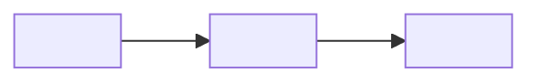
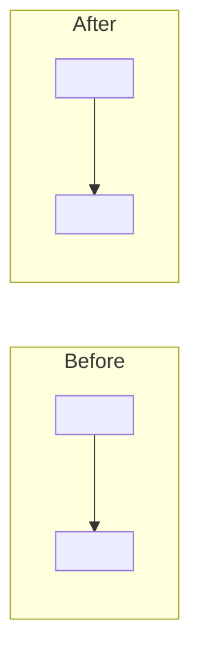

# Codebase Health Audit Report Template

Default to Markdown with Mermaid diagrams. Use a single-file HTML report only
when the user requests HTML; keep the same sections, inline the styles, and keep
citations readable as `path:line-line` links or text.

````md
# Codebase Health Audit: <repository>

## Executive summary

<One paragraph: observable health, highest-impact finding, and major uncertainty.>

### Fix this first

1. **<finding ID and title>** — <why first; smallest first step; validation route>
2. ...

## Audit boundary

- Workspace: `<absolute path>`
- Revision or working-tree state: ...
- Included: ...
- Excluded: ...
- Security scope: separate / explicitly included specialist result
- Scan status and time: ...
- Engines/providers used: ...
- Graph index state/freshness: ...
- Model-provider availability (if checked): ...
- Retained receipt evidence (if supplied): receipt/run ID; historical outcome;
  policy; checkpoint/member scope; current applicability; integrity/completeness
- Limitations: ...

## Health evidence matrix

| Dimension | State | What was observed | Validation | Gaps |
| --- | --- | --- | --- | --- |
| Architecture and ownership | Present/Wired/... | citations | command/result | ... |
| Build and static quality | ... | ... | ... | ... |
| Tests and safeguards | ... | ... | ... | ... |
| Likely defects and error risk | ... | ... | ... | ... |
| Observability and operations | ... | ... | ... | ... |
| Dependencies and configuration | ... | ... | ... | ... |
| Documentation and change safety | ... | ... | ... | ... |

## Current architecture

<Domain-language description with citations.>



## Validation ledger

| Route or receipt | Defined by | Result | Scope and what it supports now |
| --- | --- | --- | --- |
| `<exact command>` | `path:line-line` | pass/fail/skipped/blocked | bounded claim |
| `RUN_ID` receipt | frozen profile/gate ID | historical outcome | checkpoint/member scope; current applicability; integrity/completeness |

## Findings

### <ID> — <title>

- Category: ...
- Evidence state: ...
- Severity: Critical/High/Medium/Low
- Confidence: High/Medium/Low — <uncertainty>
- Recommendation strength: Strong/Worth exploring/Speculative
- Observed evidence: `path:line-line`; `<command>` exited <status>
- Impact: ...
- Smallest owner-aligned repair: ...
- Validation route: ...
- ADR relation: ...

#### Before / after



## Gaps and uncertainties

- Missing: ...
- Unobserved: ...
- Stale: ...
- Conflicting: ...
- Unverified: ...

## Recommended sequence

| Order | Finding | First step | Expected risk reduction | Validation |
| --- | --- | --- | --- | --- |

## Evidence index

- `path:line-line` — claim supported
- Code Scout query and resolved engine/provider — evidence collected
- Receipt/run ID, checkpoint/member scope, historical outcome, and current
  applicability — retained execution evidence; never treat inferred tests as executed
````

## Diagram rules

- The current-state diagram is factual and cited.
- A proposed after-state is a recommendation, never presented as observed fact.
- Include before/after diagrams only when the recommendation changes three or
  more relationships or would be materially harder to understand in prose.
- Label ADR conflicts beside the diagram.
- Prefer domain terms from `CONTEXT.md`; use module, interface, seam, adapter,
  depth, leverage, and locality precisely.

## HTML option

For HTML, use a compact editorial layout rather than a dashboard. Each finding
card includes files, problem, repair, impact, validation, evidence citations,
recommendation-strength badge, and an optional before/after diagram. Use one
accent color, red only for confirmed failures, amber for risks or ADR conflicts,
and slate for gaps. End with one prominent `Fix this first` card.
